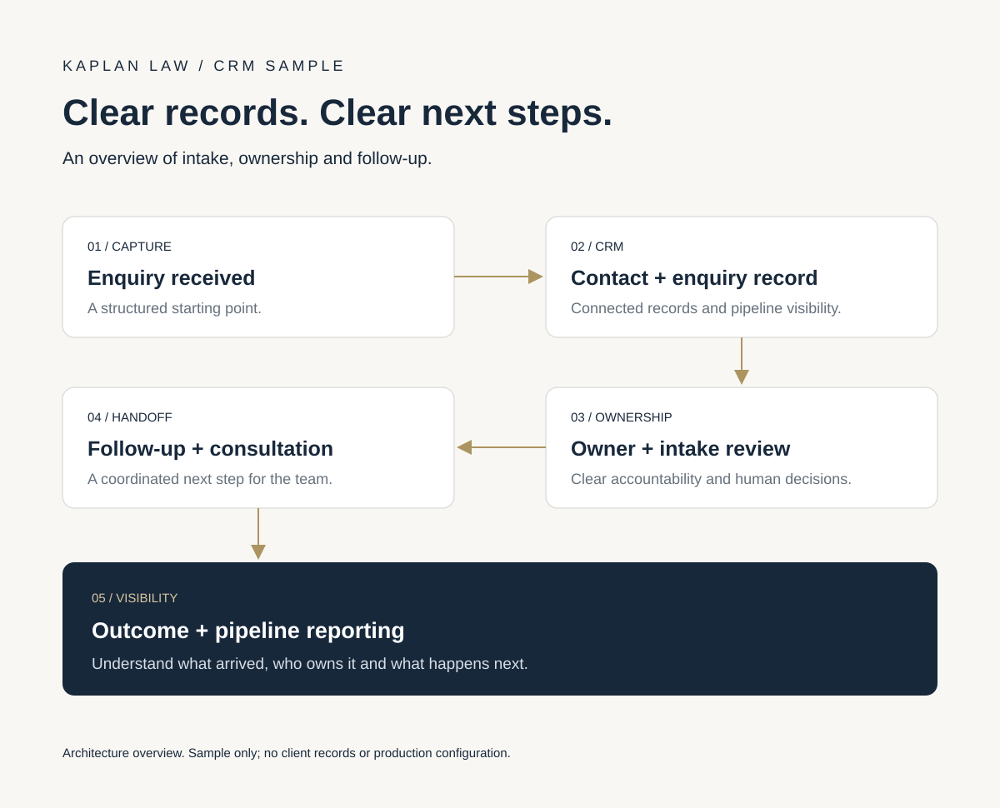

# Kaplan Law | CRM intake overview

A simplified CRM architecture sample showing how a law firm can move enquiries from first contact to a clear next step.

## Workflow at a glance

## What the system connects

- **Contacts and enquiries:** structured records and an enquiry pipeline, with clear associations.
- **Ownership:** a responsible team member and visible next action.
- **Intake review:** a human decision before progression to consultation.
- **Follow-up and booking:** coordinated tasks and handoffs, with booking kept separate from engagement.
- **Reporting:** visibility into enquiry source, current stage and follow-up status.

The focus is consistent data, clear ownership and fewer missed handoffs. Detailed matching rules, custom fields, routing conditions and production implementation are intentionally omitted.

This public sample uses no client records and is not a screenshot or export of a production portal.

[Portfolio](https://siavash.tech/) · [Discuss a CRM project on Upwork](https://www.upwork.com/freelancers/siavash/)
